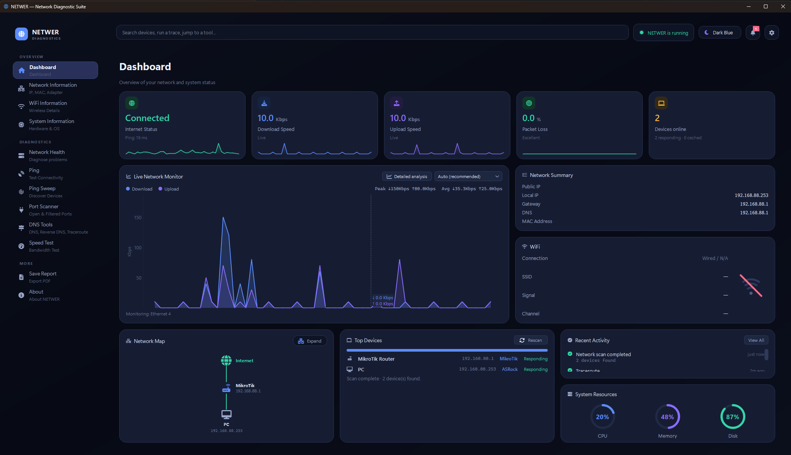
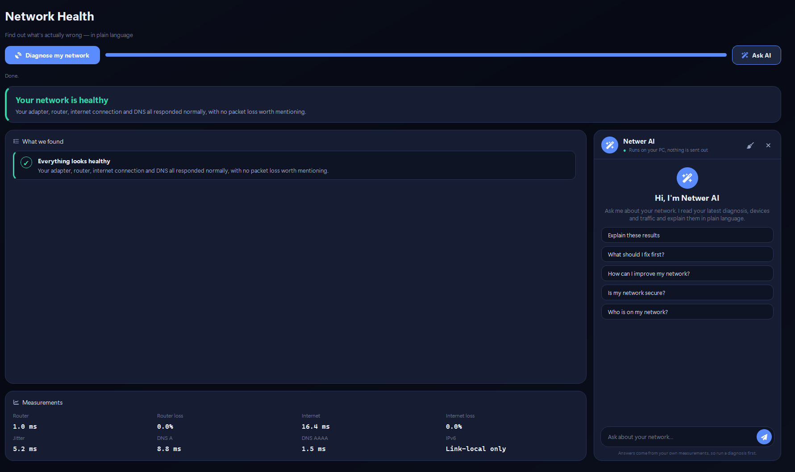
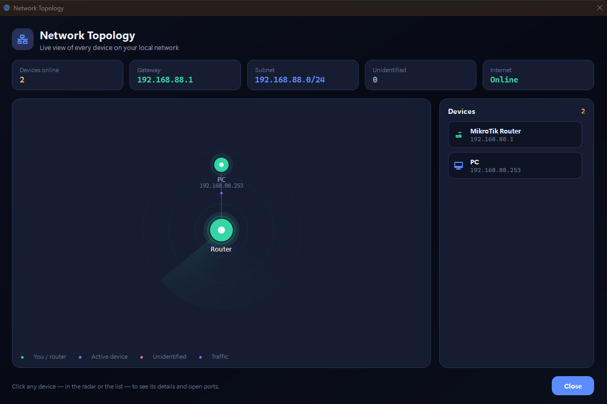

<p align="center">
  
</p>

# Netwer — Network Diagnostic Suite


## About the Project

NETWER is a free desktop application for network monitoring and diagnostics, built with **Python 3.13** and a modern **PyQt6** interface.

It is designed as an all-in-one alternative to tools like **GlassWire**, **Fing**, and parts of **Wireshark's** functionality — without subscriptions, advertisements, or unnecessary complexity.

Instead of simply displaying network statistics, NETWER tries to answer the question users actually have:

It explains network issues in plain English instead of showing only latency numbers and technical logs.


## Features

- Live network status, bandwidth, packet-loss measurements, and traffic charts.
- Local subnet scanning, device identification, and customizable device names.
- Network health diagnostics for the adapter, Wi-Fi, router, internet access, and DNS.
- Ping, traceroute, reverse DNS, port scanning, and Wake-on-LAN utilities.
- PDF network health reports and CSV device exports.
- Configurable themes and UI scaling.

## Privacy and third-party lookups

Netwer inspects local network information to provide scans and diagnostics. Some optional features may contact third-party services—for example, vendor identification and public-IP geolocation. Information sent for a lookup can include a MAC address prefix or a public IP address; private/local IP addresses are not submitted for geolocation. Third-party services have their own logging and privacy practices.

Enable **Offline privacy mode** in Settings to block optional third-party lookups. Local scanning and diagnostics continue to work, while features that depend on external lookups use available offline data or may show limited results. Ordinary network operations you initiate (such as DNS queries, speed tests, or connectivity checks) may still communicate with their configured network destinations.

## Screenshots

### Dashboard

<p align="center">
  
</p>

### Network Health

<p align="center">
  
</p>

### Network Radar

<p align="center">
  
</p>

## Technologies

| Area | Technology |
| --- | --- |
| Language | Python 3.13+ |
| Interface | PyQt6 |
| Charts | PyQtGraph |
| System information | psutil |
| Icons | QtAwesome |
| PDF reports | ReportLab |
| Numerical operations | NumPy |

## Install and run on Windows

Open PowerShell in the project directory and run:

```powershell
py -3.13 -m venv .venv
.\.venv\Scripts\Activate.ps1
python -m pip install --upgrade pip
python -m pip install -r requirements.txt
python main.py
```

To install the project and its declared dependencies in editable mode, run `python -m pip install -e .` in the activated environment. Then start it either from the project directory with `python main.py` or, from any directory, with the installed `netwer` command.

The bundled Ookla Speedtest CLI is used by default. The application also checks for `speedtest.exe` on `PATH`, on the Desktop or in Downloads, and in `C:\\speedtest`.

## Project structure

```text
NETWER/
├── main.py                 # Application entry point
├── core/                   # Networking and diagnostic logic
    ├── device_names.py
    ├── discovery.py
    ├── netwer_core.py
    ├── network.py
    ├── oui_extended.py
    ├── privacy.py
    ├── scan.py
    ├── system.py
    ├── wifi.py
    ├── windows_network.py
    ├── diagnostics.py       
    ├── vendor_learning.py
    └── device_fingerprint.py            
├── ui/
│   ├── pages/              # 12 application pages
│   ├── widgets/            # Radar, graphs, gauges, cards
│   └── components/         # Sidebar, topbar, dialogs, settings
├── app/                   # Themes, settings, resolution handling
├── workers/               # Background workers
├── docs/
    ├── screenshots        
├── reports/               # PDF report generation
└── tests/                 # Automated tests
```

## Contributing

Pull requests are welcome. For major changes, please open an issue first to discuss the proposed direction.

## License

This project is licensed under the GPLv3. See `LICENSE` for details.

## Team

Lukas Hajneman, Jan Sven Bukovski, and Erik Celjak.
